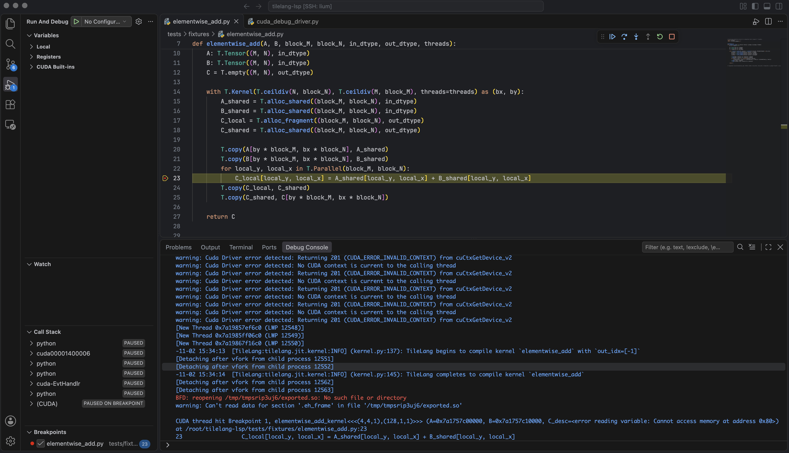

# TileLang VS Code Edition

[中文 README](./README_zh.md)

Language support and CUDA device debugging for [TileLang](https://github.com/tile-ai/tilelang)
in Visual Studio Code.

## Features

### Language Server Protocol

- Inlay hints for buffer shapes, dtypes, storage scopes, inferred layouts, parallel loops,
  and kernel launch geometry.
- Hover details and source-level diagnostics.
- Static hints and diagnostics remain available while a kernel is incomplete or cannot compile.
- VS Code and other LSP clients, including Neovim.

### CUDA debugging

- Breakpoints and device stepping mapped back to TileLang Python source lines through `cuda-gdb`.
- CUDA kernel, thread, local-variable, register, and disassembly inspection through NVIDIA Nsight.
- Full device debug information with `-G`, or faster line-only debugging with `-lineinfo`.
- Generated CUDA source browsing alongside the original Python kernel.

## Installation

### Requirements

- Python 3.8 or later. TileLang is optional for static LSP analysis and required for full analysis.
- For CUDA debugging: Linux with an NVIDIA GPU, CUDA Toolkit with `nvcc` and `cuda-gdb`, and
  TileLang >= 0.1.15.
- For VS Code CUDA debugging: [NVIDIA Nsight VS Code Edition](https://marketplace.visualstudio.com/items?itemName=nvidia.nsight-vscode-edition).

### Build from source

Install the `tlsp` Python package from the repository root:

```bash
python -m pip install -e .
```

Build the VS Code extension:

```bash
cd tilelang_lsp_extension
npm ci
npx --no-install vsce package
```

In VS Code, open the Extensions menu, choose **Install from VSIX...**, and select the generated
`tilelang-vscode-edition-*.vsix` file. Install Nsight as well if you plan to debug CUDA kernels.
If you installed the earlier `tilelang-type-decorator` package, uninstall it before installing
the renamed extension to avoid duplicate commands.

For Remote-SSH or WSL, install the Python package, CUDA tools, TileLang extension, and Nsight
on the remote side.

## Use the language server

1. Set `tilelang.pythonPath` to a Python interpreter that can import `tlsp`. Use an interpreter
   with TileLang installed for full analysis.
2. Open a TileLang Python file. Hints and diagnostics appear automatically.
3. When kernel arguments cannot be inferred, add a `<typecheck>` directive near the kernel:

   ```python
   # <typecheck> M=1024, N=1024, K=1024, block_M=128, kernel=matmul
   ```

See the [LSP guide](./docs/lsp.md) for all settings, target resolution, Neovim configuration,
architecture, and development commands.


## Debug CUDA kernels

### Dependencies

**Install all of the following before debugging:**

- A Linux machine with an NVIDIA GPU and CUDA Toolkit, including `nvcc` and `cuda-gdb`;
- [NVIDIA Nsight VS Code Edition](https://marketplace.visualstudio.com/items?itemName=nvidia.nsight-vscode-edition);
- A Python environment with TileLang >= 0.1.15 and `tlsp` installed.

For Remote-SSH or WSL, install the CUDA tools, Nsight, TileLang, and `tlsp` on the **remote side**.

### Start debugging

1. Set `tilelang.pythonPath` to the Python environment described above.
2. Open a Python script that executes a kernel and set a breakpoint on a TileLang device statement.
3. Run **TileLang: Debug CUDA Kernel** from the Command Palette or editor menu.
4. Inspect CUDA kernels and threads, step through device code, or use
   **TileLang: Open Generated CUDA Source** to inspect the generated `.c` and `.cu` files.

The launcher enables Python line mapping and `-G` device debugging by default. Set
`tilelang.debug.deviceDebug=false` for line-only debugging. `tilelang.debug.breakOnLaunch` can be
disabled to rely only on Python breakpoints instead of stopping at every kernel launch.

See the [CUDA debugging guide](./docs/cuda-debugging.md) for configuration, direct `cuda-gdb`
usage, source mapping, supported execution paths, and integration tests.



## Documentation

- [LSP guide](./docs/lsp.md): usage, configuration, architecture, and development.
- [CUDA debugging guide](./docs/cuda-debugging.md): setup, CLI, configuration, design, and limitations.
