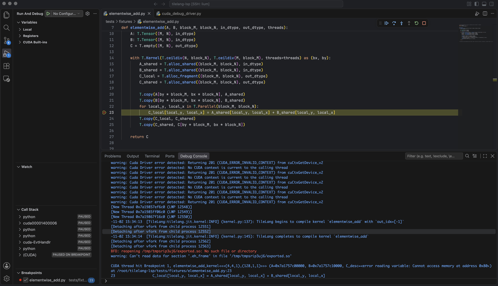

# TileLang VS Code Edition

[English README](./README.md)

在 Visual Studio Code 中为 [TileLang](https://github.com/tile-ai/tilelang) 提供语言服务和
CUDA 设备调试。

## 功能

### Language Server Protocol

- 提供 buffer shape、dtype、存储作用域、推断布局、并行循环和 kernel launch 几何信息的
  行尾提示（inlay hints）。
- 提供 hover 详情和源码级诊断。
- kernel 尚未写完或无法编译时，仍可提供静态提示和诊断。
- 支持 VS Code 以及 Neovim 等 LSP 客户端。

### CUDA 调试

- 通过 `cuda-gdb` 将断点和设备单步映射回 TileLang Python 源码行。
- 通过 NVIDIA Nsight 检查 CUDA kernel、线程、局部变量、寄存器和反汇编。
- 使用 `-G` 提供完整设备调试信息，或使用 `-lineinfo` 进行更快的仅行号调试。
- 对照原始 Python kernel 查看生成的 CUDA 源码。

## 安装

### 环境要求

- Python 3.8 或更高版本。静态 LSP 分析不依赖 TileLang，完整分析需要安装 TileLang。
- CUDA 调试：Linux、NVIDIA GPU、包含 `nvcc` 和 `cuda-gdb` 的 CUDA Toolkit，以及
  TileLang >= 0.1.15。
- 在 VS Code 中调试 CUDA：安装 [NVIDIA Nsight VS Code Edition](https://marketplace.visualstudio.com/items?itemName=nvidia.nsight-vscode-edition)。

### 从源码构建

在仓库根目录安装 `tlsp` Python 包：

```bash
python -m pip install -e .
```

构建 VS Code 扩展：

```bash
cd tilelang_lsp_extension
npm ci
npx --no-install vsce package
```

在 VS Code 的扩展菜单中选择 **Install from VSIX...**，安装生成的
`tilelang-vscode-edition-*.vsix`。需要 CUDA 调试时，同时安装 Nsight。
如果安装过旧版 `tilelang-type-decorator` 扩展，请先卸载，避免重命名后的扩展注册重复命令。

使用 Remote-SSH 或 WSL 时，Python 包、CUDA 工具、TileLang 扩展和 Nsight 都需要安装在远端。

## 使用语言服务

1. 将 `tilelang.pythonPath` 设置为能够导入 `tlsp` 的 Python 解释器。需要完整分析时，
   选择安装了 TileLang 的解释器。
2. 打开 TileLang Python 文件，提示和诊断会自动显示。
3. 无法推断 kernel 实参时，在 kernel 附近添加 `<typecheck>` 指令：

   ```python
   # <typecheck> M=1024, N=1024, K=1024, block_M=128, kernel=matmul
   ```

完整设置、target 解析、Neovim 配置、工作原理和开发命令见 [LSP 指南](./docs/lsp_zh.md)。


## 调试 CUDA kernel

### 依赖要求

**调试前必须安装以下依赖：**

- 配备 NVIDIA GPU 的 Linux 机器，以及包含 `nvcc` 和 `cuda-gdb` 的 CUDA Toolkit；
- [NVIDIA Nsight VS Code Edition](https://marketplace.visualstudio.com/items?itemName=nvidia.nsight-vscode-edition)；
- 安装了 TileLang >= 0.1.15 和 `tlsp` 的 Python 环境。

使用 Remote-SSH 或 WSL 时，CUDA 工具、Nsight、TileLang 和 `tlsp` 都必须安装在**远端**。

### 开始调试

1. 将 `tilelang.pythonPath` 设置为上述 Python 环境。
2. 打开实际执行 kernel 的 Python 脚本，在 TileLang 设备语句上设置断点。
3. 通过命令面板或编辑器菜单运行 **TileLang: Debug CUDA Kernel**。
4. 检查 CUDA kernel 和线程、单步执行设备代码，或通过
   **TileLang: Open Generated CUDA Source** 查看生成的 `.c` 和 `.cu` 文件。

启动器默认启用 Python 行映射和 `-G` 设备调试。将 `tilelang.debug.deviceDebug=false`
可改为仅行号调试。关闭 `tilelang.debug.breakOnLaunch` 后，可以只依赖 Python 断点，
避免每次 kernel launch 都停止。

配置、直接使用 `cuda-gdb` 的方法、行映射原理、支持的执行路径和集成测试见
[CUDA 调试指南](./docs/cuda-debugging_zh.md)。



## 文档

- [LSP 指南](./docs/lsp_zh.md)：使用方法、配置、工作原理和开发。
- [CUDA 调试指南](./docs/cuda-debugging_zh.md)：安装配置、CLI、设计原理和使用限制。
